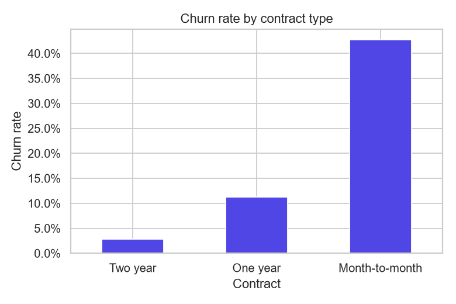

# Customer Churn Predictor

Predicts how likely a telecom customer is to cancel their subscription, so a retention team can contact the right people first.

**[Live demo →](https://ravshanovna-churn.vercel.app)** — fill in a customer profile and get a churn probability instantly. The model runs in your browser (ONNX Runtime Web), no server needed.



## Results

Held-out test set (20%, 1,409 customers):

| Metric | Score |
|---|---|
| ROC-AUC | **0.842** |
| Accuracy | 80.3% |
| Precision (churn) | 65.1% |
| Recall (churn) | 55.3% |

5-fold cross-validation on the training set:

| Model | ROC-AUC | F1 |
|---|---|---|
| **Logistic Regression** (chosen) | 0.846 | 0.594 |
| Random Forest | 0.848 | 0.578 |
| Gradient Boosting | 0.848 | 0.586 |
| XGBoost | 0.844 | 0.586 |

All models perform about the same, so I picked Logistic Regression: it's the simplest and easiest to explain. Lowering the decision threshold to 0.3 raises recall to 75%, which suits a retention campaign where a missed churner costs more than an extra call.

## Key findings

- Month-to-month contracts churn at **~43%**, two-year contracts at **~3%**.
- Short tenure, fiber-optic internet, electronic-check payments and no tech support all raise risk.
- Business idea: offer month-to-month fiber customers a discounted 1-year plan with tech support.

## Approach

1. **Cleaning** — 11 blank `TotalCharges` values all belong to brand-new customers (tenure 0), so they are set to 0.
2. **Pipeline** — `ColumnTransformer` with scaling for numeric columns and one-hot encoding for categorical ones, wrapped in a single scikit-learn `Pipeline` (no leakage across folds).
3. **Model selection** — stratified 5-fold CV comparing linear and tree-based models.
4. **Evaluation** — a single final check on an untouched test set: confusion matrix, ROC curve, threshold trade-off.
5. **Explainability** — permutation importance and logistic-regression coefficients.
6. **Deployment** — the full pipeline (preprocessing + model) is exported to ONNX and verified against scikit-learn before shipping to the static web app.

## Project structure

```
├── notebook.ipynb     # EDA, model comparison, evaluation (with outputs)
├── train.py           # reproducible training + ONNX export
├── export_utils.py    # ONNX export / verification helpers
├── requirements.txt
└── web/               # static demo deployed on Vercel
    ├── index.html, app.js, style.css
    ├── model.onnx     # exported pipeline
    ├── meta.json      # form schema, metrics, comparison
    └── assets/        # charts
```

## Run locally

```bash
pip install -r requirements.txt
python train.py                         # trains, evaluates, writes web/model.onnx
python -m http.server 8000 -d web       # open http://localhost:8000
```

## Tech

Python · pandas · scikit-learn · XGBoost · matplotlib/seaborn · skl2onnx · ONNX Runtime Web · Vercel

**Dataset:** [IBM Telco Customer Churn](https://github.com/IBM/telco-customer-churn-on-icp4d) (7,043 customers).
